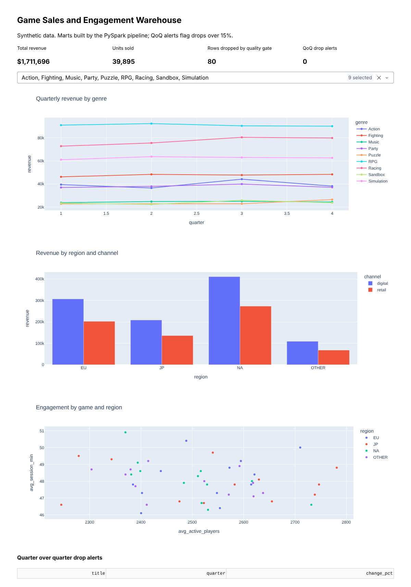

# Game Sales and Engagement Warehouse

A synthetic star-schema warehouse built two ways (pandas + SQLite, and PySpark), with a data-quality gate, three marts, QoQ revenue-drop alerts, an R statistics layer, a Plotly Dash dashboard, an AWS Lambda handler, and container/Kubernetes manifests. **All data is generated, not real.**



## Layout
| Path | What it does |
|---|---|
| `src/generate_raw.py` | Generates raw sales/games/engagement CSVs with injected dirt (40 duplicate IDs, 25 negative revenues, orphan keys) |
| `src/pipeline.py` | pandas + SQLite pipeline: quality gate, star schema, marts, alerts |
| `src/spark_pipeline.py` | PySpark version of the same logic (window functions for dedupe and QoQ lag) |
| `tests/test_spark_parity.py` | Proves Spark marts and alerts match the SQLite marts |
| `analysis/revenue_stats.R` | Base R: Welch t-test, ANOVA + Tukey, linear model with game fixed effects, chi-square on counts |
| `dashboard/app.py` | Plotly Dash dashboard over the marts |
| `src/lambda_handler.py` | Lambda that runs the pipeline and uploads marts to S3 (tested with moto) |
| `dbt_project/` | dbt models and tests over the marts |
| `agent/` | Tool-calling analytics agent (SQL + doc search); evaluation needs your own API key |
| `Dockerfile`, `k8s/cronjob.yaml` | Container image, nightly CronJob, dashboard Deployment |

## Run it
```
pip install -r requirements.txt
python src/generate_raw.py && python src/pipeline.py      # pandas + SQLite
python src/spark_pipeline.py                              # PySpark (needs Java 17+; tested on 21)
Rscript analysis/revenue_stats.R                          # stats
python dashboard/app.py                                   # http://localhost:8050
pytest tests
```

Docker (build not yet verified by the author, see status below):
```
docker build -t game-warehouse:latest .
docker run --rm game-warehouse:latest                                          # PySpark pipeline
docker run --rm -p 8050:8050 game-warehouse:latest python dashboard/app.py     # dashboard
```

## Findings from the R analysis (synthetic data, so read as a demo of method)
- Revenue per unit does not differ by channel (Welch t-test p = 0.63).
- Genre explains quarterly revenue (ANOVA p < 1e-12); Tukey shows RPG and Fighting at the top.
- Quarterly trend is not significant after game fixed effects (slope 462 per quarter, p = 0.09).
- Channel mix is independent of region (chi-square on transaction counts, p = 0.42). A first version ran chi-square on revenue dollars and reported p < 2e-16, which is wrong because it treats each dollar as an observation. Fixed to use counts.

## Bugs found while building
- pandas and Spark both treat the region code `NA` (North America) as missing by default. In pandas this broke 7,960 foreign keys. Fixed with `keep_default_na=False` in pandas and a sentinel `nullValue` in Spark, covered by tests.
- Spark's `dropDuplicates` keeps an arbitrary row, which would not match pandas. Replaced with `row_number()` over file order.

## Honest status
- Verified here: pandas pipeline, PySpark pipeline and parity (local mode), R script, dashboard renders, Lambda handler against moto, YAML parses.
- **Not verified:** the Docker image build and the Kubernetes manifests were not run on a cluster (no Docker daemon or kubectl where this was built). Treat them as untested until you run `docker build` and `kubectl apply --dry-run=server`.
- Not deployed to real AWS. Not run on Snowflake. The agent evaluation has not been run with a real API key.
